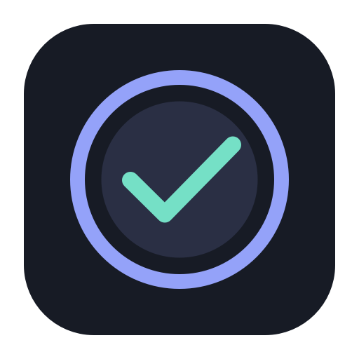
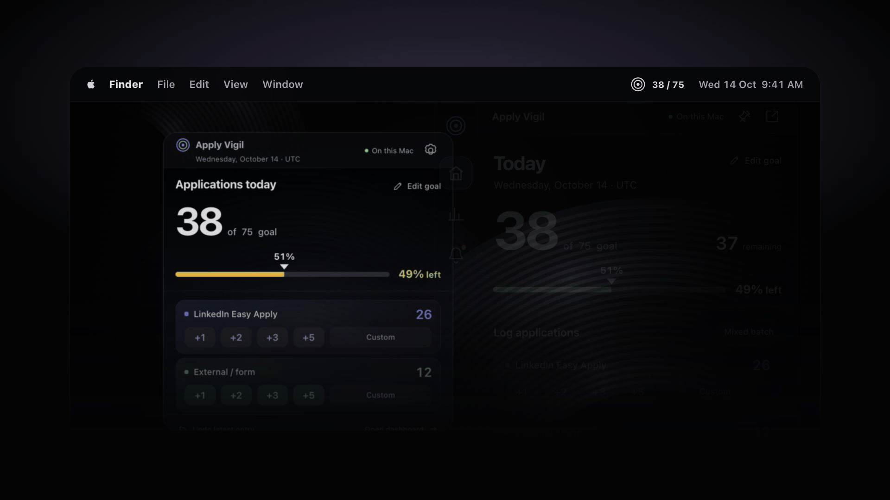
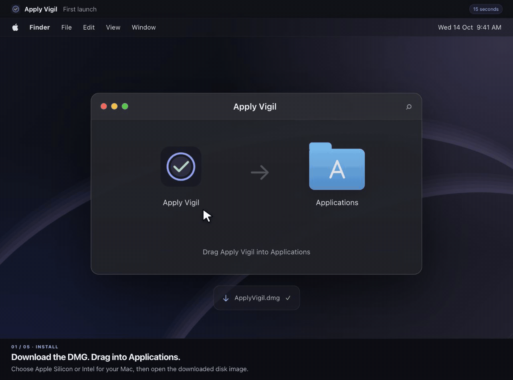

<p align="center">
  
</p>
<h1 align="center">Vigil</h1>
<p align="center">Track completed job applications. Follow your daily goal. See your progress.</p>

<h3 align="center"><a href="https://vigil.dumpydon.workers.dev/download/">↓ Download Apply Vigil for Mac</a></h3>
<p align="center">
  <a href="https://vigil.dumpydon.workers.dev/">Web app · owner workspace</a> &nbsp;·&nbsp;
  <a href="https://vigil.dumpydon.workers.dev/download/install.html">Install guide</a> &nbsp;·&nbsp;
  <a href="https://github.com/dumpydon/vigil/releases">Releases &amp; checksums</a>
</p>
<p align="center"><sub>Free beta · macOS 13+ · Apple Silicon &amp; Intel</sub></p>

<a href="https://vigil.dumpydon.workers.dev/download/">
  
</a>
<p align="center"><sub>Animated product preview · demonstration data</sub></p>

## Web & macOS

| | Apply Vigil for Mac | Vigil on the web |
| :-- | :-- | :-- |
| Experience | Menu bar + floating window; no Dock icon | Browser dashboard + compact view |
| Data & access | Local to your Mac; no account needed | Private owner workspace; sign-in, cloud sync & offline cache |

## What it does

- **Quick logging:** +1, +2, +3, +5, custom counts, and mixed batches.
- **Clear progress:** daily goals, UTC history, 7/15/30-day charts, and streaks.
- **Easy corrections:** edit past counts, undo entries, and restore JSON backups.
- **Quiet updates:** progress alerts, optional sounds, and JSON/CSV exports.

Log LinkedIn Easy Apply and external/form applications separately. Counts are entered manually; Vigil does not apply for you or access your LinkedIn account.

## First launch on Mac

The beta is ad-hoc signed and **not notarized by Apple**. If macOS blocks the first open, follow the [15-second illustrated guide](https://vigil.dumpydon.workers.dev/download/first-launch.html).

<details>
<summary>Watch the installation walkthrough</summary>

<a href="https://vigil.dumpydon.workers.dev/download/first-launch.html">
  
</a>

*Illustration; wording and authentication vary by macOS version.*

</details>

## Source & deployment

[Web app source](src/) · [macOS host](macos/) · [Download site](site/download/)

React/TypeScript + Swift/AppKit. Cloudflare Workers + D1 (Free) host the web workspace. Pushes to `main` deploy the web app and download site automatically; Mac installers are published through GitHub Releases.

[macOS guide](docs/macos.md) · [Architecture](docs/architecture.md) · [Deployment](docs/deployment.md) · [Release procedure](docs/releases.md) · [CI checks](https://github.com/dumpydon/vigil/actions/workflows/checks.yml)

<details>
<summary>Run from source</summary>

Use Node 22.14+ and npm. To set up the local web workspace:

```sh
npm ci
npm run setup:local
npm run db:migrate:local
```

Run `npm run dev:api` and `npm run dev` in separate terminals, then open [localhost:5173](http://127.0.0.1:5173/).

For the public Mac app, use `npm ci` and `npm run macos:build -- --local` on macOS. See the [native build requirements](docs/macos.md#build-test-install).

Checks: `npm run lint`, `npm test`, `npm run build`.

</details>

---

<p align="center">
  Built by <a href="https://github.com/dumpydon">@dumpydon</a> ·
  <a href="https://github.com/dumpydon/vigil/issues">Feedback</a> ·
  <a href="https://vigil.dumpydon.workers.dev/download/privacy.html">Privacy</a>
  <br><sub>Visual inspiration: <a href="https://www.vigilbar.com/">Vigilbar</a>.</sub>
</p>
