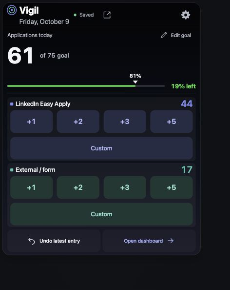
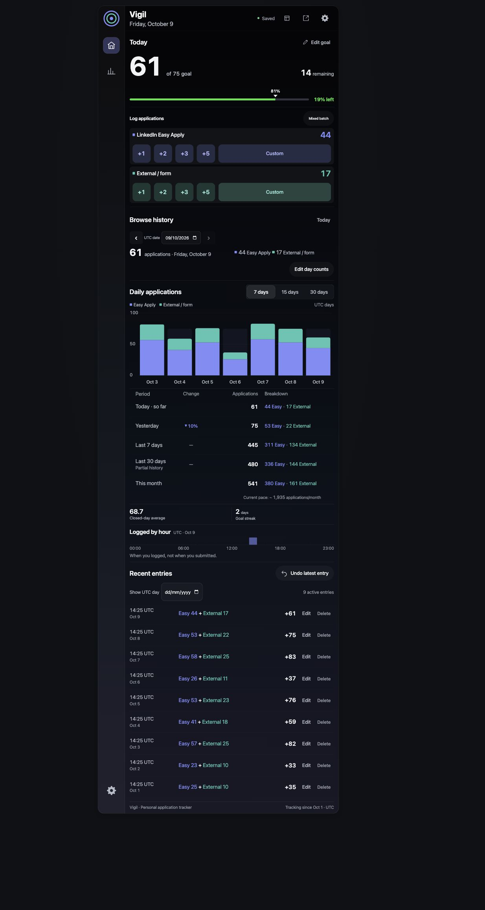
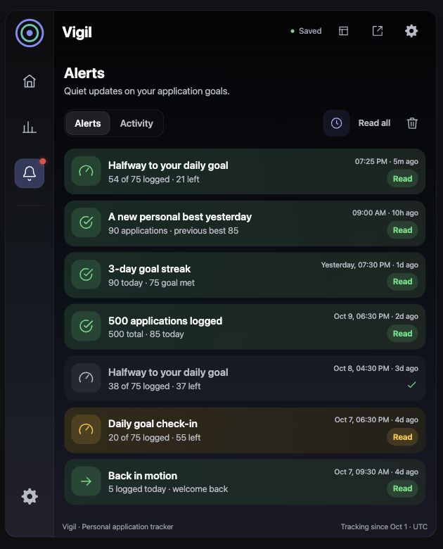

# Vigil

A personal job-application tracker for LinkedIn Easy Apply and external forms. Log what you have completed, follow your daily goal, and review your history.

**[Open Vigil](https://vigil.dumpydon.workers.dev/)** · **[Compact view](https://vigil.dumpydon.workers.dev/compact)**



<details>
<summary>View the full dashboard</summary>



</details>

<details>
<summary>View the alerts inbox</summary>



</details>

*Screenshots use demonstration data.*

## What you can do

- Add +1, +2, +3, +5, custom counts, or a mixed batch.
- Track daily progress, 7/15/30-day charts, period totals, and goal streaks.
- Correct past days with a before/after confirmation, or undo an entry.
- See quiet progress alerts: at most three per day and 21 per rolling week, retained for 15 days.
- Keep logging offline after your first sign-in and load; sync when connected.
- Export a JSON backup or CSV, and merge a backup without duplicating records.

Vigil is for one owner. Counts are entered manually; it does not submit applications.

The sidebar bell shows daily overviews, halfway progress, goal completions, streak milestones, comeback messages, best-day records, total-application milestones, evening check-ins, and Monday recaps. Alerts appear while Vigil is open and stay in the existing device cache. Read or clear them from the inbox, or pause them for the current UTC day.

## Floating compact view

In desktop Chrome, click **Pop out compact view** in the top row. The compact card stays above other tabs and apps, can be moved and resized, and shares live counts with the dashboard. **Open dashboard** returns to the source tab.

Keep the source tab open: closing or refreshing it closes the floating card. Other browsers can use the regular compact view; unsupported floating-window requests show a message.

## Run locally

Use Node 22.14+ and npm:

```sh
npm ci
npm run setup:local
npm run db:migrate:local
```

Setup asks for an owner password using a hidden prompt and saves ignored local secrets. Start these in separate terminals:

```sh
npm run dev:api
npm run dev
```

Open **http://127.0.0.1:5173/**. Local development uses its own database and browser storage, separate from production.

## Development and deployment

```sh
npm run lint
npm test
npm run build
```

React and TypeScript power the interface. A Cloudflare Worker serves the app and API; D1 stores saved records, while IndexedDB retains cached records and pending changes.

This installation uses Cloudflare Free. Pushes to GitHub **main** automatically build and deploy through Workers Builds. Ordinary deployments retain existing secrets and data; schema migrations are applied separately.

- [Architecture and data behavior](docs/architecture.md)
- [Deployment, credentials, and installation](docs/deployment.md)
- [Verification notes](docs/verification.md)

All days use UTC, starting at **00:00 UTC / 05:30 IST**. The default goal is 75. **Saved** means the server has acknowledged your changes. Keep regular JSON backups; clearing browser storage can erase unsynced work.

The visual style is inspired by Vigilbar. Vigil is an independent personal tracker with custom SVG assets and system fonts.
